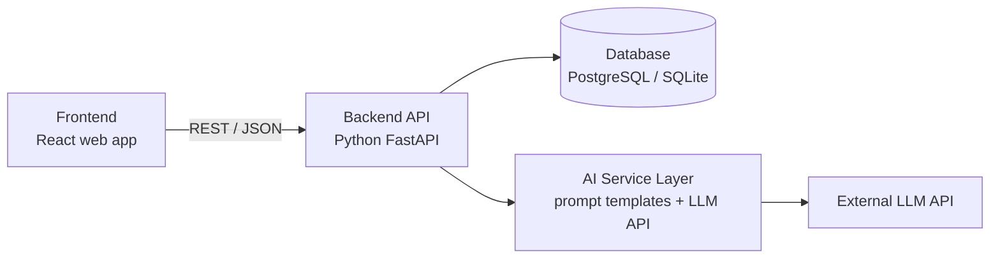

# Architecture Plan

Project: **AI Bug Triage Assistant**

## 1. Overview
A web application where users submit bug reports and an AI service automatically triages them (severity, category, probable causes, next steps, duplicate detection). Team leads review results on a dashboard and can override the AI.

## 2. High-Level Architecture

## 3. Components

| Component | Responsibility | Suggested Tech |
|-----------|----------------|----------------|
| **Frontend** | Bug submission form, bug detail page, dashboard with sorting/filtering, comments, AI feedback buttons | React, Tailwind CSS |
| **Backend API** | Validation, CRUD for bugs/comments/users, triggers AI triage, applies manual overrides, assignment and status updates | Python, FastAPI |
| **AI Service Layer** | Builds prompts from bug data, calls the LLM, parses structured JSON output (severity, category, causes, next steps, confidence), finds likely duplicates | Prompt templates, LLM API |
| **Database** | Stores users, bugs, triage results, comments (see `data_model.md`) | PostgreSQL (SQLite for local dev) |

## 4. Main Data Flow (bug submission)
1. Reporter submits a bug in the frontend.
2. Backend validates and saves the bug with status `open`.
3. Backend sends the bug text to the AI Service Layer.
4. AI Service Layer compares it with existing bugs (duplicate check) and asks the LLM for severity, category, probable causes and next steps.
5. The result is saved as a `TriageResult`, and the bug's severity/category are updated.
6. Frontend shows the triaged bug; the Team Lead can accept or override it.

## 4.1 API Endpoints (draft)
| Method | Endpoint | Purpose |
|--------|----------|---------|
| POST   | `/bugs` | Submit a new bug (triggers AI triage) |
| GET    | `/bugs` | List bugs (filter by severity, category, status) |
| GET    | `/bugs/{id}` | Bug details with triage result and comments |
| PATCH  | `/bugs/{id}` | Override severity/category, assign, change status |
| POST   | `/bugs/{id}/comments` | Add a comment |
| POST   | `/bugs/{id}/triage/feedback` | Send helpful / not helpful feedback |

## 5. AI Design
- Prompt template with role, bug input, and a required JSON output schema.
- Output validation: reject and retry once if the JSON is invalid.
- Confidence score stored with every result; low-confidence results are flagged for manual review.
- Duplicate detection: compare new bug with existing ones (text similarity or embeddings) and pass the top matches to the LLM.
- Human override always wins (`is_manual_override`).

## 6. Non-Functional Considerations
- **Security:** API key stored in environment variables, input validation, no secrets in the repo.
- **Performance:** AI call runs asynchronously so submission feels instant; result appears when ready.
- **Reliability:** If the AI call fails, the bug is still saved and can be re-triaged later.
- **Testing:** Unit tests for the API, mock LLM responses for AI layer tests.

## 7. Deployment (MVP)
- Local development with SQLite.
- Simple deployment of frontend and backend on a free hosting platform; PostgreSQL for the hosted version.
