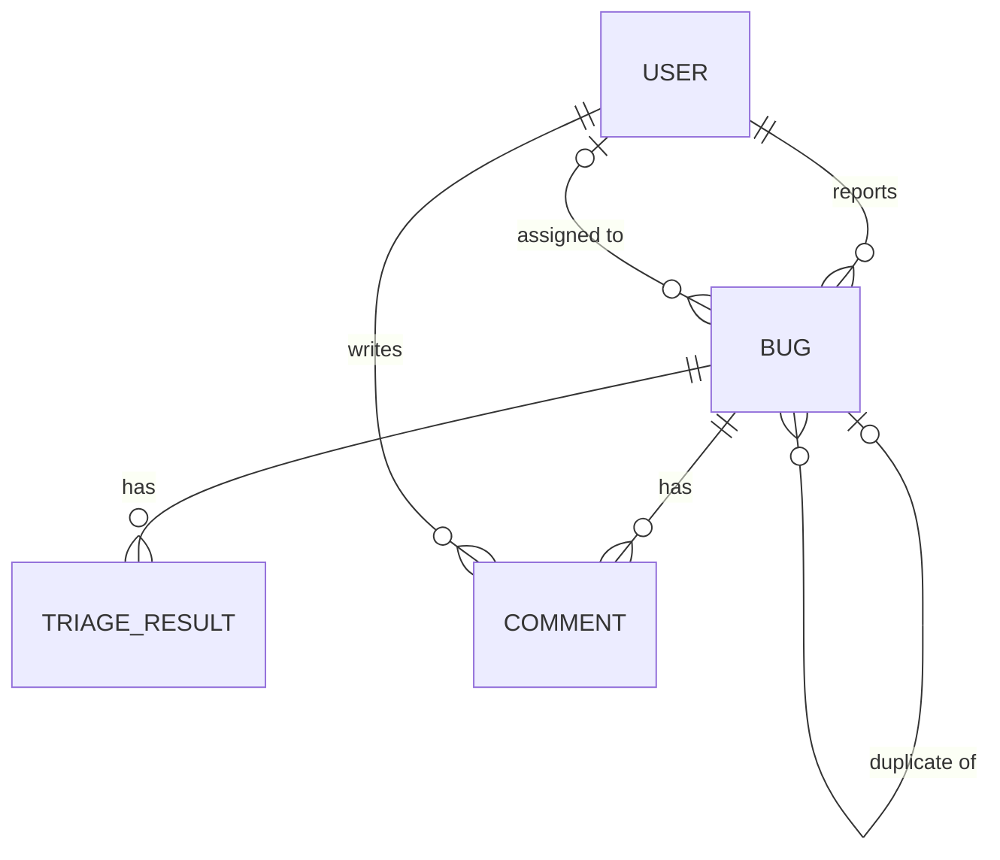

# Data Model

Project: **AI Bug Triage Assistant**

## Entities

### User
| Field         | Type      | Notes                                   |
|---------------|-----------|-----------------------------------------|
| id            | UUID (PK) |                                         |
| name          | string    |                                         |
| email         | string    | unique                                  |
| role          | enum      | `reporter`, `developer`, `team_lead`    |
| created_at    | datetime  |                                         |

### Bug
| Field             | Type      | Notes                                                |
|-------------------|-----------|------------------------------------------------------|
| id                | UUID (PK) |                                                      |
| title             | string    |                                                      |
| description       | text      |                                                      |
| steps_to_reproduce| text      |                                                      |
| severity          | enum      | `low`, `medium`, `high`, `critical`                  |
| category          | enum      | `ui`, `backend`, `performance`, `security`, `other`  |
| status            | enum      | `open`, `in_progress`, `resolved`                    |
| is_manual_override| boolean   | true if severity/category was edited by a person     |
| reporter_id       | UUID (FK) | → User.id                                            |
| assignee_id       | UUID (FK) | → User.id, nullable                                  |
| duplicate_of_id   | UUID (FK) | → Bug.id, nullable                                   |
| created_at        | datetime  |                                                      |
| updated_at        | datetime  |                                                      |

### TriageResult
| Field           | Type      | Notes                                         |
|-----------------|-----------|-----------------------------------------------|
| id              | UUID (PK) |                                               |
| bug_id          | UUID (FK) | → Bug.id                                      |
| suggested_severity | enum   | same values as Bug.severity                   |
| suggested_category | enum   | same values as Bug.category                   |
| probable_causes | text      | AI-generated                                  |
| next_steps      | text      | AI-generated                                  |
| confidence      | float     | 0.0 – 1.0                                     |
| feedback        | enum      | `helpful`, `not_helpful`, nullable            |
| created_at      | datetime  |                                               |

### Comment
| Field      | Type      | Notes            |
|------------|-----------|------------------|
| id         | UUID (PK) |                  |
| bug_id     | UUID (FK) | → Bug.id         |
| author_id  | UUID (FK) | → User.id        |
| text       | text      |                  |
| created_at | datetime  |                  |

## Relationships
- A **User** (reporter) can create many **Bugs**; a **Bug** has one reporter.
- A **User** (developer) can be assigned many **Bugs**; a **Bug** has zero or one assignee.
- A **Bug** has one or more **TriageResults** (one per AI run).
- A **Bug** has many **Comments**; a **User** can write many **Comments**.
- A **Bug** can optionally point to another **Bug** as its duplicate.

## ER Diagram

