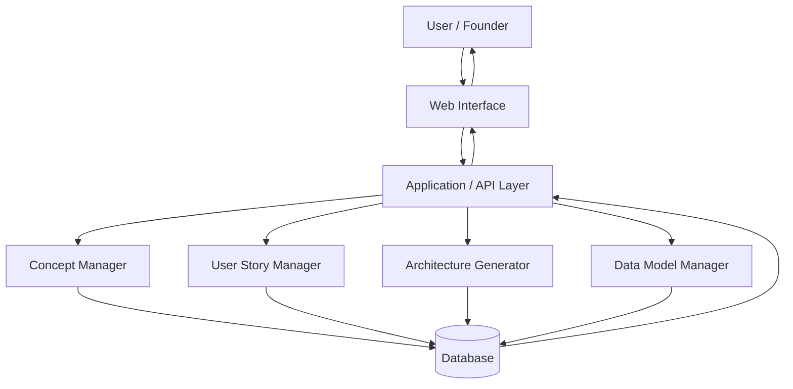

# High-Level System Architecture - AI-Powered Startup MVP Builder

## Overview

The MVP follows a simple layered architecture. A user provides startup information through the interface, the application processes the input and creates structured MVP requirements, and the resulting data is stored for later review and editing.

## System Diagram

## Main Components

### 1. Web Interface
Provides forms and views where users can enter startup ideas, problems, target users, features, and constraints.

### 2. Application / API Layer
Receives user input and coordinates the main application functions.

### 3. Concept Manager
Creates and manages the MVP concept, including the problem statement, target users, core features, and constraints.

### 4. User Story Manager
Stores and manages actionable user stories generated from the MVP concept.

### 5. Architecture Generator
Maintains the high-level architecture description and system relationships.

### 6. Data Model Manager
Defines and manages the entities and relationships required by the MVP.

### 7. Database
Stores MVP concepts, user stories, features, and related project information.

## Data Flow

1. The user enters a startup idea.
2. The web interface sends the information to the application layer.
3. The application organizes the information into MVP requirements.
4. User stories, architecture information, and data-model information are created or updated.
5. The data is stored in the database.
6. The application returns the structured requirements to the user.
