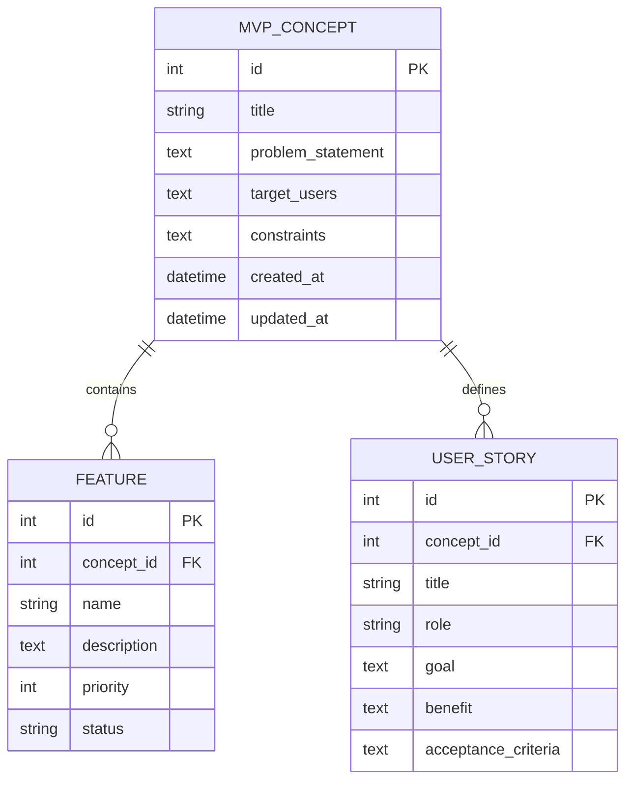

# Data Model - AI-Powered Startup MVP Builder

## Overview

The MVP uses a simple relational data model. The main entities are `MVPConcept`, `Feature`, and `UserStory`.

## Entity 1: MVPConcept

Represents the startup MVP being defined.

| Field | Type | Description |
|---|---|---|
| id | integer | Unique identifier |
| title | string | Name of the MVP |
| problem_statement | text | Problem the MVP solves |
| target_users | text | Description of intended users |
| constraints | text | MVP limitations and boundaries |
| created_at | datetime | Creation timestamp |
| updated_at | datetime | Last update timestamp |

## Entity 2: Feature

Represents a core feature belonging to an MVP concept.

| Field | Type | Description |
|---|---|---|
| id | integer | Unique identifier |
| concept_id | integer | ID of the related MVP concept |
| name | string | Feature name |
| description | text | Feature description |
| priority | integer | Feature priority |
| status | string | Planned, in-progress, or completed |

## Entity 3: UserStory

Represents an actionable requirement from the user's perspective.

| Field | Type | Description |
|---|---|---|
| id | integer | Unique identifier |
| concept_id | integer | ID of the related MVP concept |
| title | string | Short user story title |
| role | string | User role |
| goal | text | What the user wants to accomplish |
| benefit | text | Why the user needs it |
| acceptance_criteria | text | Conditions for considering the story complete |

## Relationships

- One `MVPConcept` can have many `Feature` records.
- One `MVPConcept` can have many `UserStory` records.
- Each `Feature` belongs to one `MVPConcept`.
- Each `UserStory` belongs to one `MVPConcept`.

## Relationship Diagram

